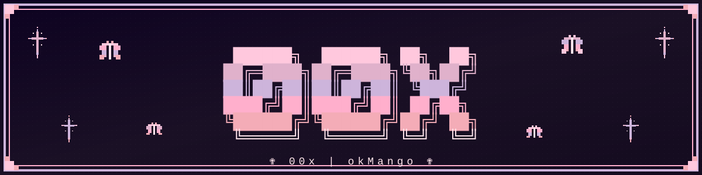

<div align="center">



<br/>

<a href="https://git.io/typing-svg">
  
</a>

<br/>

**✟ 𝕹𝖀𝕷𝕷𝖀𝕸 𝕸𝕬𝕲𝕹𝖀𝕸 𝕴𝕹𝕲𝕰𝕹𝕴𝖀𝕸 𝕾𝕴𝕹𝕰 𝕸𝕴𝖃𝕿𝖀𝖁𝕬 𝕯𝕰𝕸𝕰𝕹𝕿𝕴𝕬𝕰 ✟**

<br/>

<a href="https://github.com/0kmango?tab=followers">
  
</a>


<br/><br/>


`[ OPERATOR: 00x ]` • `[ ALIAS: 0kmango ]` • `[ BASE: JAVA POO ]` • `[ DOMAIN: CYBERSECURITY ]` • `[ STATUS: ACTIVE ]`

<br/>

### ✟ ─── ❖ [ DOSSIER // MANIFIESTO DEL SISTEMA ] ❖ ─── ✟

<div align="left">

> *"0kMangoo."*

```text
[CONFIDENTIAL // CLASSIFIED DOSSIER]
✟ CODENAME      : 00x
✟ IDENTITY      : 0kmango
✟ ARCHITECTURE  : Programación Orientada a Objetos (POO)
✟ CORE LANGUAGE : Java (JVM Ecosystem)
✟ SPECIALTY     : Ciberseguridad Ofensiva & Defensiva, Pentesting, Hardening
✟ ENVIRONMENT   : Linux (Kali Linux / Arch)
✟ PALETTE       : Purple // Celeste // Pink
✟ MOTIF         : Pixel Butterflies & Gothic Crosses
```

</div>

<br/>


### ✟ ─── ❖ [ PILARES TÉCNICOS & ARQUITECTURA ] ❖ ─── ✟

<div align="left">

#### ✟ 01. NÚCLEO: PROGRAMACIÓN ORIENTADA A OBJETOS (JAVA)

Mi base de ingeniería se fundamenta en el rigor de la **POO en Java**, diseñando software modular, escalable, tipado y resistente a fallos:

- **Principios Cardinales:** Encapsulamiento hermético, abstracción de modelos complejos, jerarquías de herencia limpias y polimorfismo dinámico.
- **Arquitectura de Software:** Principios **SOLID**, separación de responsabilidades y patrones de diseño GoF (*Factory, Singleton, Observer, Strategy, Decorator*).
- **Entorno JVM:** Gestión eficiente de memoria, manejo robusto de excepciones y concurrencia multihilo (*Threads, Concurrency Utilities*).

#### ✟ 02. DISCIPLINA: CIBERSEGURIDAD & ANÁLISIS OFENSIVO

Auditoría y fortificación de sistemas mediante una mentalidad de seguridad por diseño (*Security by Design*):

- **Auditoría & Pentesting:** Reconocimiento de superficies de ataque, análisis de vulnerabilidades y pruebas de penetración.
- **Seguridad de Redes:** Análisis de tráfico con Wireshark, inspección de paquetes, escaneo proactivo con Nmap y mapping de topologías.
- **Desarrollo Seguro:** Prevención de inyecciones, saneamiento estricto de buffers, criptografía aplicada y auditoría estática de código.

</div>

<br/>


### ✟ ─── ❖ [ PROYECTOS // SISTEMA EN OPERACIÓN ] ❖ ─── ✟

| PROYECTO | DESCRIPCIÓN | STACK | ESTADO |
| :--- | :--- | :--- | :---: |
| [**MangoBot**](https://github.com/0kmango/MangoBot) | Bot de Discord musical con funciones adicionales e IA integrada | `Python` `Discord API` | 🟢 **Activo** |
| [**MangoRed**](https://github.com/0kmango/MangoRed) | Monitor Doméstico de Red Local para Kali Linux | `Python / JavaScript` `Seguridad` `Redes` | 🟢 **Activo** |

<br/>

```text
  ✟ ───────────────────────────────────────────────────────────── ✟
                 ██████╗  ██████╗ ██╗  ██╗
                ██╔═████╗██╔═████╗╚██╗██╔╝
                ██║██╔██║██║██╔██║ ╚███╔╝ 
                ████╔╝██║████╔╝██║ ██╔██╗ 
                ╚██████╔╝╚██████╔╝██╔╝ ██╗
                 ╚═════╝  ╚═════╝ ╚═╝  ╚═╝
         ⸸  J A V A   O O P   //   S E C U R I T Y  ⸸
  ✟ ───────────────────────────────────────────────────────────── ✟
```

<br/>


### ✟ ─── ❖ [ ARSENAL & HERRAMIENTAS // DARK STACK ] ❖ ─── ✟

#### ✟ LENGUAJE NÚCLEO & ARQUITECTURA POO ✟


#### ✟ CIBERSEGURIDAD, HACKING ÉTICO & AUDITORÍA ✟


#### ✟ SISTEMAS, INFRAESTRUCTURA & AUTOMATIZACIÓN ✟


<br/>


### ✟ ─── ❖ [ EL DEMONIO DEL SISTEMA // 00x.java ] ❖ ─── ✟

<div align="left">

```java
package root.shadows;

import security.defense.VulnerabilityScanner;
import architecture.oop.CleanArchitecture;

/**
 * ✟ 00x // Autonomous Sentinel Daemon ✟
 * Base: Object-Oriented Architecture & Security Analysis
 * Aesthetic: Pixel Butterflies & Gothic Crosses
 */
public final class ZeroZeroX extends Architect implements ExploitAuditor {

    private final String alias        = "00x";
    private final String operative    = "0kmango";
    private final String baseParadigm = "POO (Object-Oriented Programming)";
    private final String language     = "Java";
    private final String domain       = "Cybersecurity";

    public ZeroZeroX() {
        super(SecurityLevel.MAXIMUM);
        initializeSubsystems();
    }

    @Override
    public void executeLifeCycle() {
        while (isAlive()) {
            // ✟ POO: Fortalecer estructura y modularidad
            CleanArchitecture.enforceSOLIDPrinciples();

            // ✟ Ciberseguridad: Escaneo e inspección continua
            VulnerabilityScanner.auditNetworkPerimeter();

            // ✟ Resiliencia en las sombras
            sleepInDarkness(Interval.CONSTANT);
        }
    }

    public static void main(String... args) {
        System.out.println("✟ [00x] SYSTEM ONLINE: IN UMBRIS POTESTAS ✟");
        new ZeroZeroX().executeLifeCycle();
    }
}
```

</div>

<br/>


### ✟ ─── ❖ [ TELEMETRÍA // RECON STATS ] ❖ ─── ✟

|  |  |
| :---: | :---: |

<br/>


<br/><br/>


### ✟ ─── ❖ [ TRANSMISIÓN & CONTACTO // ROOT TERMINAL ] ❖ ─── ✟

*« Las conexiones seguras no dejan rastro. Para comunicaciones directas o intercambio de llaves: »*

<a href="https://github.com/0kmango">
  
</a>
<a href="https://discord.com/users/xdarkz.z">
  
</a>
<a href="https://www.linkedin.com/in/martina-norambuena-26ba68339/">
  
</a>

<br/><br/>

```text
✟ 00x // 0kmango • ALL RIGHTS RESERVED IN THE ABYSS • 2026 ✟
```


</div>
